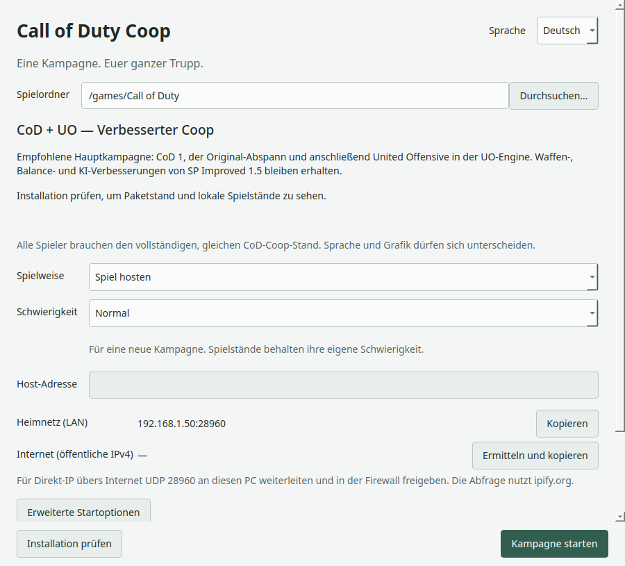
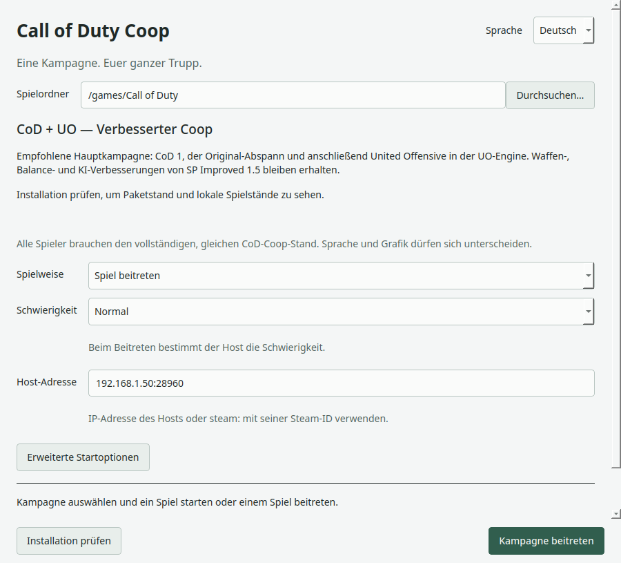

# Gemeinsam spielen mit CoDCoop

[Installation](../README.de.md#installation) · [CoDCoop starten](../README.de.md#codcoop-starten) · [Probleme beim Beitritt](#probleme-beim-beitritt) · [English](connect.md)

## Verbindung auswählen

| Wo spielt ihr? | Was der Mitspieler verwendet |
| --- | --- |
| Im selben WLAN oder kabelgebundenen Netz | [Heimnetz (LAN)](#im-selben-heimnetz), z. B. `192.168.1.50:28960` |
| Von verschiedenen Anschlüssen, mit UDP-Portweiterleitung beim Host | [Öffentliche IPv4](#über-das-internet-per-direkt-ip), z. B. `203.0.113.42:28960` |
| Von verschiedenen Anschlüssen, über Steam-Freunde | [Steam-Einladung oder Steam-ID](#steam) |
| Von verschiedenen Anschlüssen, über Tailscale | [Tailscale-IPv4](#über-tailscale), z. B. `100.64.10.20:28960` |

Die Adressen sind Beispiele. Verwendet die Adresse der Person, die euer Spiel hostet.

## Hosten und beitreten

Alle brauchen dieselbe CoDCoop-Version und Kampagne. Für die kombinierte Kampagne lasst ihr im Launcher **CoD + UO — Verbesserter Coop** ausgewählt.

1. **Host:** Unter **Spielweise** wählst du **Spiel hosten** und klickst auf **Kampagne starten**. Wähle im Spielmenü **Co-op**, um deine Lobby zu sehen. Wenn du das Spiel direkt über Steam geöffnet hast, wähle dort **Host game**, um die Lobby zu öffnen. Du kannst auch zuerst eine Mission starten oder laden und deine Mitspieler danach beitreten lassen.
2. **Mitspieler:** Wähle im Launcher **Spiel beitreten**, trage die **Host-Adresse** ein und klicke auf **Kampagne beitreten**. Wenn die passende Kampagne bereits offen ist, geht es im Spiel über **Co-op → Host IP → Join**. Für Einladungen folge den [Steam-Schritten](#steam).
3. **Wenn ihr euch in der Lobby trefft:** Warte, bis die Mitspieler in der Liste stehen. Der Host geht zurück ins Spielmenü und startet oder lädt eine Mission. Die wartenden Mitspieler folgen automatisch.

Wenn ihr die Partie über den CoDCoop Launcher gestartet habt, lasst ihn offen, damit die Gruppe einem Kampagnenwechsel folgen kann. Wenn sich beide in derselben Mission bewegen können, steht die Verbindung.

Launcher-Ansichten für Host und Mitspieler anzeigen

**Host.** Die Heimnetz-Adresse ist direkt kopierbar. Mit **Ermitteln und kopieren** fragst du bei Bedarf die Internet-Adresse ab.

**Mitspieler.** Wähle **Spiel beitreten**, füge die Adresse samt Port ein und klicke auf **Kampagne beitreten**.

## Im selben Heimnetz

1. **Host:** Klicke im Launcher neben **Heimnetz (LAN)** auf **Kopieren** und teile die Adresse samt Port, zum Beispiel `192.168.1.50:28960`.
2. **Mitspieler:** Füge sie als **Host-Adresse** ein und klicke auf **Kampagne beitreten**. Beide Rechner müssen sich im erreichbaren Heimnetz befinden. Ein Gast-WLAN kann die Geräte voneinander trennen.
3. Falls der Beitritt abläuft, erlaube auf dem Host eingehendes **UDP 28960** in der Firewall. Im Heimnetz braucht ihr keine Portweiterleitung im Router.

## Über das Internet per Direkt-IP

1. **Host:** Leite im Router **UDP 28960** an die lokale IPv4 deines Rechners und Port **28960** weiter. Erlaube dort eingehendes UDP auf diesem Port in der Firewall.
2. Klicke im Launcher unter **Internet (öffentliche IPv4)** auf **Ermitteln und kopieren**. Teile diese Adresse. Wenn der Router einen anderen externen Port nutzt, ersetze den kopierten Port. Bei extern `3202` und intern `28960` trägt der Mitspieler zum Beispiel `203.0.113.42:3202` ein.
3. **Mitspieler:** Füge von einem anderen Internetanschluss die öffentliche Adresse als **Host-Adresse** ein und klicke auf **Kampagne beitreten**.

Falls der Anschluss des Hosts keine eingehende IPv4-Verbindung zulässt, probiert [Steam](#steam) oder [Tailscale](#über-tailscale).

## Steam

1. Meldet euch mit getrennten Steam-Konten an und fügt euch als Freunde hinzu. Falls Steam die Installation von Spacewar verlangt, öffnet angemeldet `steam://install/480` und wartet, bis Steam fertig ist.
2. **Host:** Aktiviere für den Spieleintrag das Steam-Overlay und starte den Eintrag über Steam. Wähle **Co-op → Host game** und lade eine Mission. Öffne mit **Umschalt+Tab** das Overlay, wähle deinen Freund und klicke auf **Zum Spiel einladen**.
3. **Mitspieler:** Öffne dieselbe Kampagne mit dem CoDCoop Launcher, bevor du die Einladung annimmst. Klicke im Steam-Chat auf **Spiel spielen**. Wenn im **Co-op**-Menü **Join [Name]** erscheint, kannst du auch dort beitreten. Für einen Beitritt per Steam-ID trägst du im Launcher `steam:<SteamID64>` als **Host-Adresse** ein.

Steam-Eintrag für deine Kampagne einrichten

Wähle in Steam **Spiele → Steam-fremdes Spiel meiner Bibliothek hinzufügen → Durchsuchen** und wähle die EXE im installierten Spielordner. **Original** verwendet `CoDSP.exe`. **Verbesserter Coop** verwendet `CoDUOSP.exe` mit `+set fs_game sp_improved +set coop_mainline 1` unter **Eigenschaften → Startoptionen**. Unter Linux braucht der Eintrag außerdem Proton und die CoDCoop-Startoptionen für Grafik und Mod-DLL. [Proton und Steam einrichten](linux.de.md#4-steam-einrichten) · [Valve zum Overlay](https://partner.steamgames.com/doc/features/overlay)

Falls Steam einen separaten **Spacewar**-Einrichtungsdialog öffnet, startet CoDCoop und nehmt die Einladung erneut an. Die Anzeige Spacewar bedeutet, dass das Spiel bei Steam angemeldet ist. Prüft, ob beide in derselben Mission landen.

## Über Tailscale

Ihr verwendet das IP-Feld im Launcher. Die Portweiterleitung im Router kann geschlossen bleiben.

1. Installiert Tailscale auf beiden Rechnern und meldet euch an. Unter Windows nutzt ihr das Tailscale-Symbol im Infobereich. Unter Linux installiert ihr das Paket eurer Distribution, startet den Dienst, führt `sudo tailscale up` aus und öffnet den Anmeldelink. [Windows einrichten](https://tailscale.com/docs/install/windows) · [Linux einrichten](https://tailscale.com/docs/install/linux)
2. Nutzt ein gemeinsames Tailscale-Netz oder gebt nur den Host-Rechner für den Mitspieler frei. Der Mitspieler sollte den Host in seiner Tailscale-Geräteliste sehen. Wenn ihr die Host-Rolle tauscht, gebt auch den anderen Rechner frei. [Gerät freigeben](https://tailscale.com/docs/features/sharing)
3. **Host:** Kopiere die Tailscale-IPv4 aus der App oder rufe `tailscale ip -4` auf. Ergänze den Spielport und teile das Ergebnis, etwa `100.64.10.20:28960`. Erlaube eingehendes Spiel-UDP über Tailscale in der Host-Firewall und in eigenen Tailscale-Zugriffsregeln.
4. **Mitspieler:** Füge die Tailscale-Adresse samt Port als **Host-Adresse** ein und klicke auf **Kampagne beitreten**.

Tailscale-Verbindung prüfen

Führe `tailscale ping 100.64.10.20` mit der tatsächlichen Host-Adresse aus, ohne den Spielport. Antwortet Tailscale und scheitert der Spielbeitritt trotzdem, prüft, ob das Spiel hostet und ob UDP-Port und Firewall stimmen. Während der Partie zeigt `tailscale status`, ob die Verbindung direkt, über einen DERP-Relay oder über einen Peer-Relay läuft. Relays können die Verzögerung erhöhen. [Tailscale-Verbindungsarten](https://tailscale.com/docs/reference/connection-types)

## Probleme beim Beitritt

- **„Campaign is not prepared“.** Schließe `CoDMP.exe`, falls du den Standard-Mehrspielermodus gestartet hast. Öffne den CoDCoop Launcher, wähle die Kampagne des Hosts und klicke auf **Installation prüfen**. Wenn eine Datei fehlt, führe das Setup erneut aus.
- **Nach „Kampagne wird gestartet“ bleibst du im Hauptmenü.** Prüfe beim IP-Beitritt die Adresse und den Port. Wenn die Kampagne bereits offen ist, verwende **Co-op → Host IP → Join**. Bei Steam lasst ihr CoDCoop auf beiden Rechnern offen und nehmt die Einladung erneut an.
- **Die Verbindung läuft ab.** Prüft, ob der Host eine Lobby oder Mission geöffnet hat. Bei öffentlicher IP kontrolliert ihr die UDP-Regel im Router und die Host-Firewall. Bei Tailscale hilft dessen Ping-Prüfung.
- **Ihr braucht weitere Hilfe.** Sichert auf beiden Rechnern `codcoop.log` und, falls vorhanden, `codcoop_join.log` aus dem Ordner neben `CoDSP.exe`. Gebt CoDCoop-Version, Kampagne und Verbindungsweg an.

Konsole öffnen

Drücke während einer Mission **P**, wenn die Taste beim Einrichten der Belegung frei war. Die ursprüngliche Taste unter **Esc** (auf deutschen Tastaturen meist **^**) funktioniert auch im Menü. Aktiviere bei Bedarf **Konsole** in den Spieloptionen. Um **P** neu zu belegen, gib in der Konsole `bind p coopconsole` ein.

Getestete Verbindungswege für 0.6.3

Der Steam-ID-Beitritt wurde mit zwei Konten von einer Windows-VM zu einem Linux-Host über Steam Relay geprüft. Die beiden Rechner nutzten denselben physischen Internetanschluss. Die Release-Notizen führen die noch offenen Prüfungen für den endgültigen Build auf, darunter die Overlay-Einladung, den Spielbeitritt per öffentlicher IPv4 über zwei physische Anschlüsse und den Spielbeitritt in einem echten Tailscale-Netz. [Teststand im Release](https://github.com/benjarogit/CoDCoop/releases/tag/v0.6.3)

