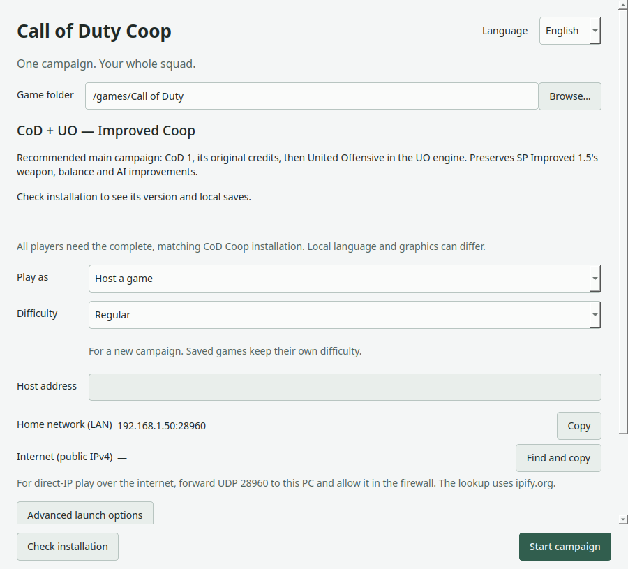
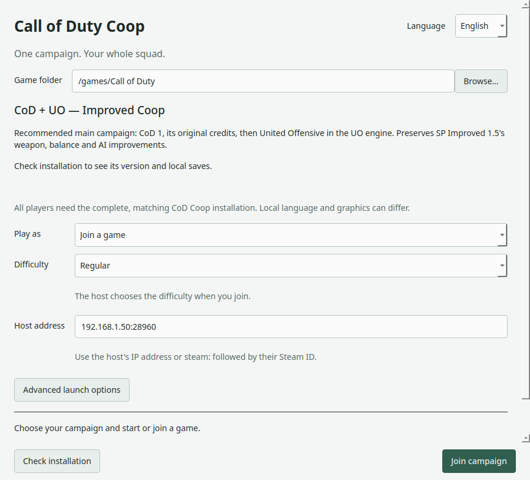

# Play together in CoDCoop

[Installation](../README.md#installation) · [Start CoDCoop](../README.md#start-codcoop) · [Troubleshoot a join](#troubleshoot-a-join) · [Deutsch](connect.de.md)

## Choose your connection

| Where are you playing? | What the guest uses |
| --- | --- |
| On the same Wi-Fi or wired network | [Home network (LAN)](#on-the-same-home-network), e.g. `192.168.1.50:28960` |
| At different homes, with UDP forwarding on the host’s router | [Public IPv4](#direct-ip-over-the-internet), e.g. `203.0.113.42:28960` |
| At different homes, using Steam friends | [Steam invitation or Steam ID](#steam) |
| At different homes, using Tailscale | [Tailscale IPv4](#over-tailscale), e.g. `100.64.10.20:28960` |

The addresses here are examples. Use the address of the player hosting your game.

## Host and join

Everyone needs the same CoDCoop release and campaign. Start with **CoD + UO — Improved Coop** selected in the launcher for the combined campaign.

1. **Host:** Set **Play as** to **Host a game**, then click **Start campaign**. When the game menu opens, select **Co-op** to see your lobby. If you opened the game directly through Steam, select **Host game** in that menu to begin hosting. You can also start or load a mission first and have friends join while you play.
2. **Guest:** In the launcher, choose **Join a game**, enter the host’s address under **Host address**, then click **Join campaign**. If the right campaign is already open, use **Co-op → Host IP → Join** in the game. For Steam invitations, follow the [Steam steps](#steam).
3. **If you meet in the lobby:** Wait until you see your friends in the lobby. The host goes back to the game menu and starts or loads a mission. Waiting players follow automatically.

For games started from the CoDCoop Launcher, keep it open during play so the group can follow campaign changes. When both players can move in the same mission, the connection is ready.

Show what the host and guest select in the launcher

**Host.** The home-network address is ready to copy. Use **Find and copy** to look up the internet address when you need it.

**Guest.** Choose **Join a game**, paste the address including the port, then click **Join campaign**.

## On the same home network

1. **Host:** In the launcher, click **Copy** next to **Home network (LAN)** and share the address and port, such as `192.168.1.50:28960`.
2. **Guest:** Paste it into **Host address** and click **Join campaign**. Both computers must be on the same reachable network. Guest Wi-Fi may isolate devices.
3. If the guest times out, allow incoming **UDP 28960** on the host’s firewall. Router port forwarding is unnecessary for LAN play.

## Direct IP over the internet

1. **Host:** Forward **UDP 28960** on your router to your computer’s local IPv4 on port **28960**. Allow incoming UDP on that port in the host firewall.
2. In the launcher, click **Find and copy** under **Internet (public IPv4)** and share the result. If the router uses a different external port, replace the port in the copied address. For example, external `3202` forwarded to internal `28960` means the guest enters `203.0.113.42:3202`.
3. **Guest:** From a different internet connection, paste that public address into **Host address** and click **Join campaign**.

If the host’s internet service does not provide reachable inbound IPv4, try [Steam](#steam) or [Tailscale](#over-tailscale).

## Steam

1. Sign in to separate Steam accounts and add each other as friends. If Steam prompts for Spacewar, open `steam://install/480` while signed in and let Steam finish the installation.
2. **Host:** Enable the Steam overlay for the game entry and start that entry through Steam. Choose **Co-op → Host game** and load a mission. Open the overlay with **Shift+Tab**, select your friend and choose **Invite to Play**.
3. **Guest:** Open the same campaign with the CoDCoop Launcher before accepting the invitation. In Steam chat choose **Play Game**. If the entry appears in the game’s **Co-op** menu, you can also use **Join [name]**. To join by Steam ID, enter `steam:<SteamID64>` in the launcher’s **Host address** field.

Set up the Steam entry for your campaign

In Steam, choose **Games → Add a Non-Steam Game to My Library → Browse** and select the executable in your installed game folder. **Original** uses `CoDSP.exe`. **Improved Coop** uses `CoDUOSP.exe` with `+set fs_game sp_improved +set coop_mainline 1` in **Properties → Launch Options**. On Linux, the entry also needs Proton and the CoDCoop launch options for graphics and the mod DLL. [Set up Proton and Steam](linux.md#4-steam-friend-invites) · [Valve overlay documentation](https://partner.steamgames.com/doc/features/overlay)

If Steam opens a separate **Spacewar** setup dialog, start CoDCoop and accept the invite again. Seeing Spacewar in Steam means the game signed in to Steam. Check that both players enter the same mission.

## Over Tailscale

This works through the launcher’s IP field. The host can leave router forwarding for the game port closed.

1. Install and sign in to Tailscale on both computers. On Windows, use the Tailscale tray icon. On Linux, install the package for your distribution, start the service, run `sudo tailscale up`, and open the sign-in link. [Windows setup](https://tailscale.com/docs/install/windows) · [Linux setup](https://tailscale.com/docs/install/linux)
2. Use a shared Tailscale network or share just the host’s device with the guest. The guest should see that device in their Tailscale list. Share the other device too if you swap host roles. [Device sharing](https://tailscale.com/docs/features/sharing)
3. **Host:** Copy your Tailscale IPv4 from the app or run `tailscale ip -4`. Add the game port and share the result, for example `100.64.10.20:28960`. Allow incoming game UDP on the Tailscale interface in your firewall and any custom Tailscale access policy.
4. **Guest:** Paste the Tailscale address and port into **Host address**, then click **Join campaign**.

Check the Tailscale connection

Run `tailscale ping 100.64.10.20`, substituting the actual host address and leaving off the game port. If Tailscale responds but the game times out, check that the game is hosting, and check the UDP port and firewall. During play, `tailscale status` shows whether the route is direct, via a DERP relay, or via a peer relay. Relay connections may add latency. [Tailscale connection types](https://tailscale.com/docs/reference/connection-types)

## Troubleshoot a join

- **“Campaign is not prepared.”** Close `CoDMP.exe` if you launched standard multiplayer. Open the CoDCoop Launcher, select the host’s campaign, and click **Check installation**. If it reports a missing file, run setup again.
- **“Starting the campaign” ends at the main menu.** For IP joins, check the address and port. If the campaign is already open, use **Co-op → Host IP → Join**. For Steam, keep CoDCoop open on both computers and accept the invite again.
- **The join times out.** Check that the host has opened a lobby or loaded a mission. For a public IP, check the router’s UDP rule and the host firewall. For Tailscale, try its ping check.
- **You still need help.** Save `codcoop.log` and, if present, `codcoop_join.log` from the folder containing `CoDSP.exe` on both computers. Include the CoDCoop release, campaign and connection method.

Open the console

Press **P** during a match if the key was free when the mod set up the binding. The original key below **Esc** (backtick/tilde on a US keyboard) also works in the menu. Enable **Console** in the game options if needed. To rebind **P**, enter `bind p coopconsole` in the console.

Connection test coverage for 0.6.3

The Steam-ID join was verified with two accounts, from a Windows VM to a Linux host over Steam Relay. The two machines used one physical internet connection. The release notes track the outstanding checks for the exact release build, including the overlay invitation, public IPv4 gameplay across two physical connections and gameplay in a live Tailscale network. [Release test notes](https://github.com/benjarogit/CoDCoop/releases/tag/v0.6.3)

